<div align="center">

# VeriDoc

**From handshake to contract.**
A promise made in chat should be a promise you can prove.


Srujana Hackathon, problem LS-06: *From Handshake to Contract*

</div>

<p align="center">
  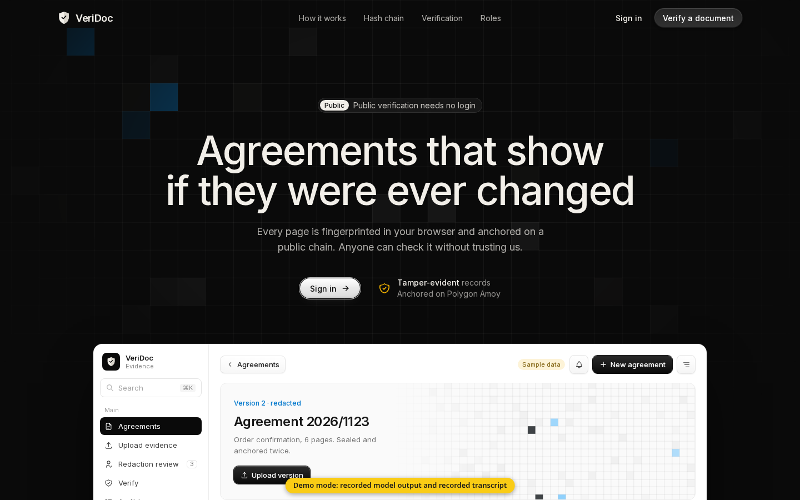
</p>

VeriDoc is a drafting and record-keeping aid, not legal advice. It makes a record **tamper-evident**: it shows that a record was not changed after it was saved. It cannot prove that the original chat was genuine.

## Contents

1. [Overview](#overview)
2. [How it works](#how-it-works)
3. [Architecture](#architecture)
4. [Product tour](#product-tour)
5. [Evidence vault and anchoring](#evidence-vault-and-anchoring)
6. [Offline engine and model](#offline-engine-and-model)
7. [What is real today](#what-is-real-today)
8. [Documents](#documents)
9. [Tech stack](#tech-stack)
10. [Repository layout](#repository-layout)
11. [Run it](#run-it)
12. [Smart contract](#smart-contract)
13. [Limits](#limits)
14. [Origins](#origins)
15. [Contributors](#contributors)

## Overview

Small deals in India are agreed on WhatsApp. Price and quantity are usually clear. The delivery date, the advance and the balance due date often are not, and the gap shows up weeks later when one side will not pay or deliver. Asking a regular customer to sign a contract feels like distrust, so people do not. A chat screenshot is weak evidence.

VeriDoc works inside the conversation people already have. It reads the chat, proposes the terms with the exact message each one came from, says what is stated, unclear, contradicted or missing, suggests the next message to send, and writes a short plain-language recap that the other person confirms by replying with a code. The chat, the confirmed terms and the recap are saved in a hash-based evidence vault, and anyone can check the receipt on a public page with no account.

| | |
|---|---|
| **Who it is for** | Small suppliers and shops, freelancers, tutors, contractors, landlords, caterers and event vendors who agree deals in chat |
| **What it removes** | The vague or missing term nobody noticed until a dispute |
| **What it keeps private** | The offline engine analyses a chat on the user's own laptop with no internet |
| **What it proves** | A saved record was not changed afterwards (tamper evidence) |
| **What it does not do** | Give legal advice, predict how a dispute would be decided, or prove the original chat was genuine |

### The problem in numbers

These are the figures the team collected; sources are in [`docs/PROJECT_REPORT.md`](docs/PROJECT_REPORT.md) section 2.

| Figure | Value | Source |
|---|---|---|
| Delayed payments owed to MSMEs | 7.34 lakh crore rupees (March 2024) | GAME-FISME Delayed Payments Report 3.0 |
| Payment claims rejected by MSE councils | About 1 in 4 | Lok Sabha answer AU2328 |
| Monthly WhatsApp users in India | About 535 million | Meta, Statista |
| Small-business owners using WhatsApp for business (India and Brazil) | 80% | Meta |
| Surveyed Indian freelancers unpaid at least once | 61% | PayPal (2018) |

The legal position, as the team researched it, is that the law already accepts chat agreements (Indian Contract Act s.10, IT Act s.10A). A court copy of a chat still needs a certificate under Bharatiya Sakshya Adhiniyam s.61 to 63, which VeriDoc does not produce. **A lawyer must confirm this before anyone relies on it.**

## How it works

**Handshake** (import the chat, see proposed terms and flags), then **Recap** (plain-language recap, confirmed with an echo code), then **Receipt** (saved in the vault, anchored, checkable).

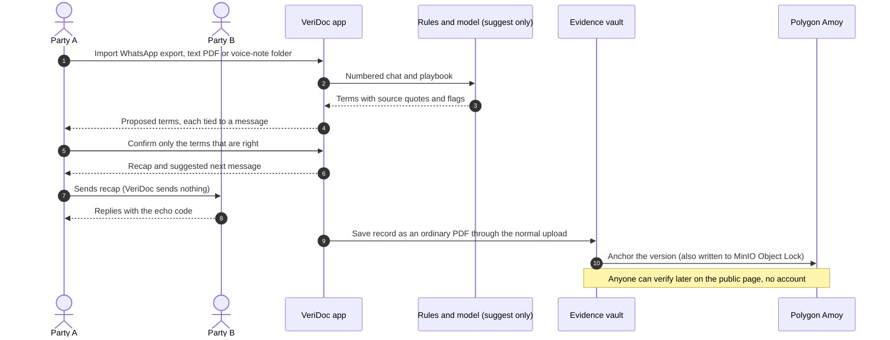

### Worked example

From the synthetic supply-order sample (`samples/veridoc/chats/supply-order.txt`): Dev orders 200 notebooks from Kavi at 45 rupees each, 9,000 in total, with 3,000 advance and 6,000 on delivery on 20 March, and the school logo free of charge.

The recorded model output used in the demo contains a deliberate mistake: it reads the price as 54 while quoting "45 per piece". VeriDoc checks the value against the quote, so that term is marked **needs review**, not stated, and the recap lists it as an open point. The only flag it raises is **unconfirmed** on the logo term: Kavi said it last and Dev did not reply. The other terms come out **stated**, each with its source message.

A second sample with a voice note (`samples/veridoc/voice-export/`): the text says 45 per piece and the voice note says 50 rupees, so the price is **contradicted**, and a text-versus-voice flag names both messages. The voice is synthetic text-to-speech and its transcript is recorded.

### The four statuses

| Status | Meaning |
|---|---|
| Stated | The term has a verbatim source quote that supports its value |
| Unclear | The wording is vague ("next week", "half") |
| Contradicted | Two messages disagree |
| Missing | The playbook requires it and the chat never mentions it |

Anything that fails a check shows as **needs review**. The seven rule flags and their rules are in [`docs/AI_SPEC.md`](docs/AI_SPEC.md).

### The six features

1. **Chat and voice note import**
2. **Term extractor**: rules first, model second; every term has a verbatim source quote and a human confirmation
3. **Ambiguity and missing-term flags**: stated, unclear, contradicted, missing
4. **Chat recommendation**: the one next message that closes the biggest gap, in three tones
5. **Plain-language agreement**: a recap in English and a Hindi draft, confirmed with an echo code
6. **Hash-based evidence vault**: salted Merkle tree, hash chain, anchored on Polygon Amoy and in MinIO (Object Lock), with a public verify page

## Architecture

VeriDoc has two components. The application and evidence vault live in this repository. The offline engine is a separate codebase that runs from a pendrive; it is not in this repository and is not yet connected to it. The planned connection is `LocalModelAdapter`, a stub today.

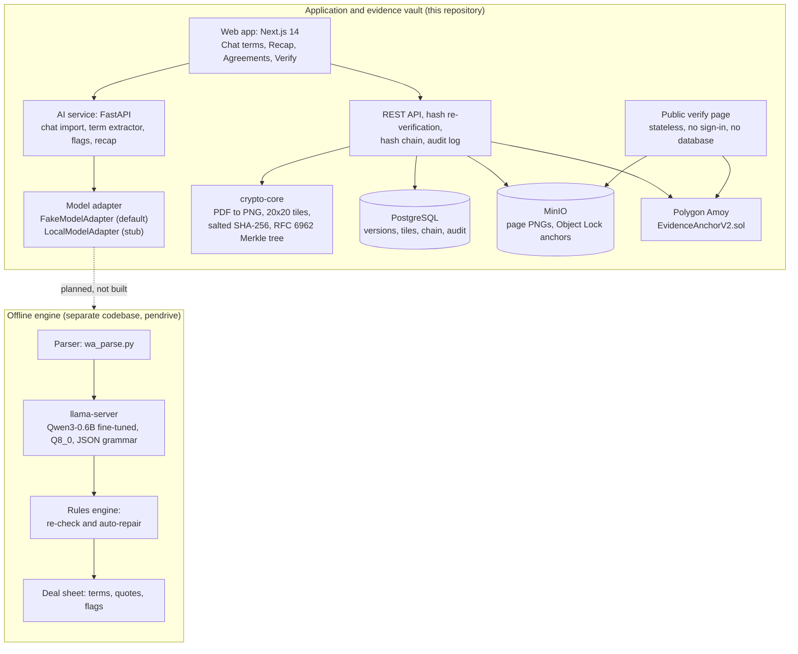

### The AI boundary

The AI only suggests. It never writes to the vault, the audit log or the hash path. The Merkle root is computed from raw tile pixel hashes, always. A model or OCR failure can never break the cryptographic proof.

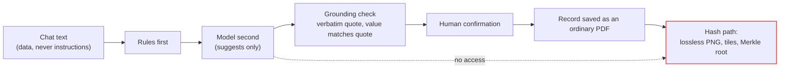

| Layer | Trusts | Does not trust |
|---|---|---|
| Browser | Computes the hashes first | |
| Server | Recomputes every hash independently | Any client-submitted hash |
| Verify page | MinIO and Polygon directly | The VeriDoc database |
| AI step | Nothing; it only proposes | Chat text, which is treated as data |

Full detail: [`docs/ARCHITECTURE.md`](docs/ARCHITECTURE.md), [`docs/02-architecture-and-dataflow.md`](docs/02-architecture-and-dataflow.md), [`docs/03-crypto-and-merkle-spec.md`](docs/03-crypto-and-merkle-spec.md).

## Product tour

Screenshots are from this repository running locally with the synthetic samples. The yellow badge is part of the product: while `MODEL_MODE=fake` every page says it is showing recorded model output.

### Terms from a chat

Every proposed term shows its status, its value and the message it came from. The deliberate price mistake in the recorded output is caught by the value-versus-quote check and shown as **needs review**.

<p align="center">
  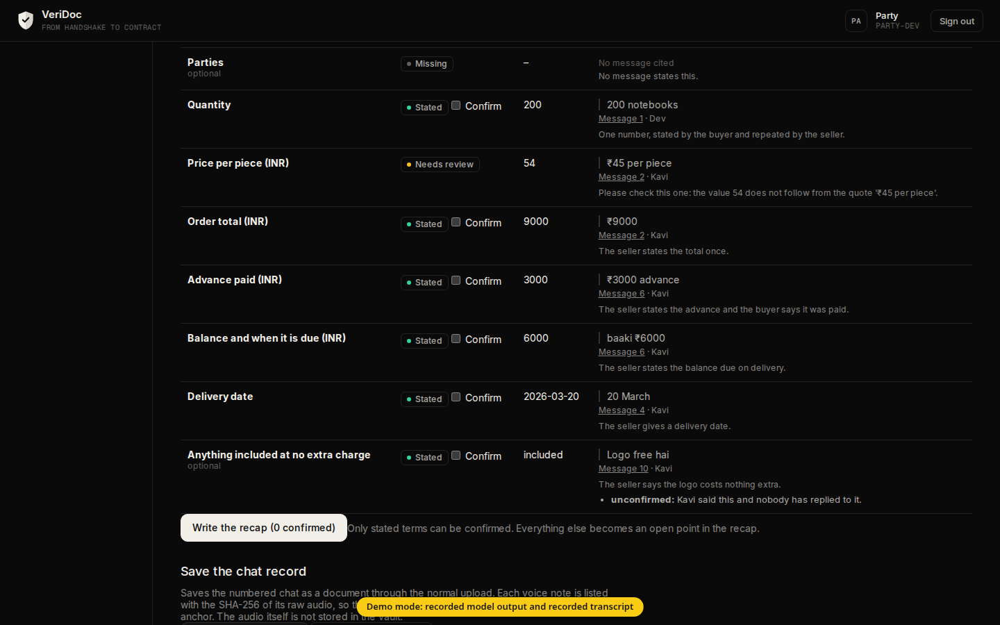
</p>

### Recap and suggested next message

The recap lists only the terms the user confirmed, from fixed templates with no model text. Open points get a suggested message in a friendly, neutral or firm tone. VeriDoc sends nothing; the user does.

<p align="center">
  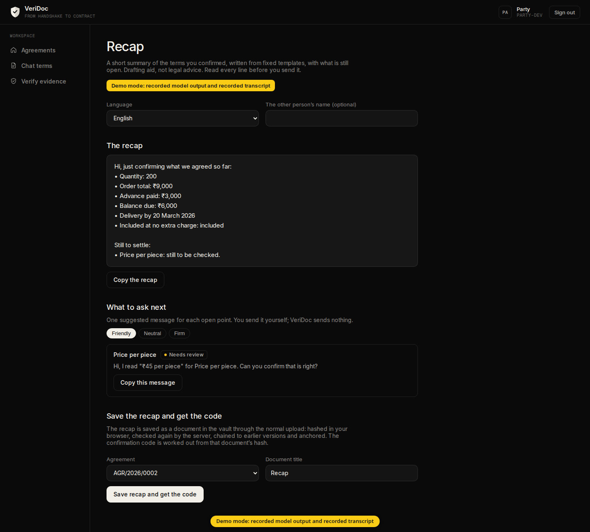
</p>

### Agreements dashboard

<p align="center">
  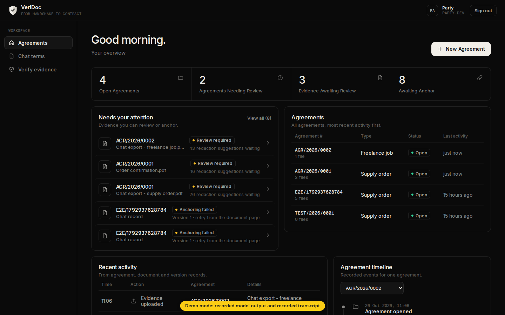
</p>

This is a local development build. It has no Polygon Amoy RPC configured, so some anchors show as failed and can be retried from the version page. Rows beginning with E2E and TEST come from end-to-end test runs.

### Redaction tiles

Documents are rendered to lossless PNG pages and split into a 20 by 20 grid of tiles. Suggested areas (names, numbers, addresses) are shown as tiles to review. A person chooses what to redact, and the redaction is itself provable.

<p align="center">
  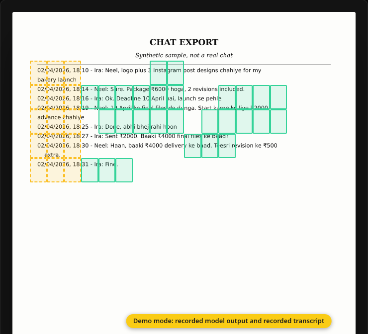
</p>

### Public verification

The verify page is public and stateless. It needs no account and no database query; it checks uploaded pages and a proof file against MinIO and Polygon directly.

<p align="center">
  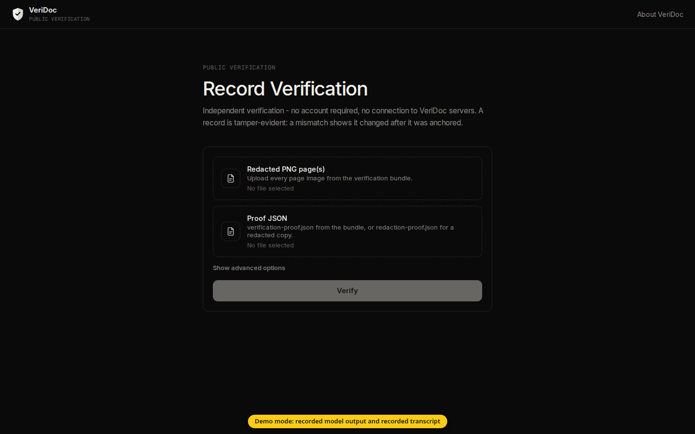
</p>

## Evidence vault and anchoring

The vault is inherited from DigiVault and is unchanged by the VeriDoc work. Chats and recaps enter it as ordinary PDFs through the normal upload, so no new hash format exists.

1. The browser renders each page to a **lossless PNG**, splits it into a **20 by 20 grid**, and computes a salted SHA-256 for each tile.
2. Tile hashes form an **RFC 6962 Merkle tree**. The root commits to the whole version.
3. The server **recomputes every hash independently**; it never trusts a client-submitted hash.
4. Each version is chained to the previous one (hash chain) and every action is written to an insert-only, hash-chained audit log.
5. The root is **anchored twice**: to MinIO with Object Lock (compliance mode) and to the **Polygon Amoy** contract `EvidenceAnchorV2.sol`.
6. Anyone can verify later on the public page.

A real anchoring transaction from the deployed contract on Polygon Amoy (testnet):

<p align="center">
  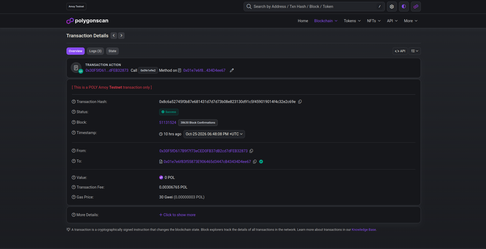
</p>

The chain holds a commitment (a hash), never document content. A mismatch on the verify page shows a record changed after it was anchored; it does not stop the change, which is why the wording is tamper-evident and never tamper-proof.

## Offline engine and model

Business chats hold prices, names and phone numbers, and many small traders work on weak networks. The offline engine carries its own model, inference runtime and Python on a pendrive: plug it into a laptop, double-click the launcher, and a chat is analysed locally in about two seconds with Wi-Fi off. It uses no account, API key, upload or cloud service.

**Scope.** The engine is a separate codebase, not in this repository and not connected to the application. It has been run on macOS (Apple Silicon). Windows and Linux builds are packaged and untested. Every figure in this section is the team's own measurement on 36 held-out, realistic, **synthetic** WhatsApp-style chats, run on 25 and 26 October 2026. It is a target until measured on real Indian chats and it is not a result for this repository's recorded demo.

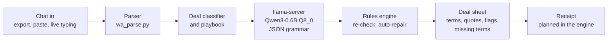

### Example session

A live Hinglish test (a caterer deal) through the shipped model, offline, 2.0 seconds. Parties are right and the delivery and balance dates are correctly listed as missing. Four terms are wrong: the negotiated price should be 420, the 5,000 is the advance rather than the total, the item should be veg catering, and "around 40" should be an unclear quantity. This is why every term carries its quote and a person confirms it.

<p align="center">
  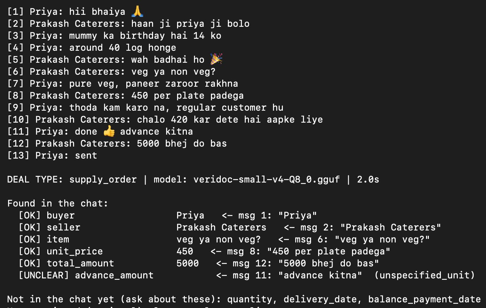
</p>

### Model

| Item | Detail |
|---|---|
| Base model | Qwen3-0.6B, 606.1 million parameters, Apache 2.0 |
| Method | LoRA on all attention and MLP projections, rank 16, alpha 32, dropout 0.05 |
| Trainable parameters | 10,092,544 (1.67%) |
| Training | 1 epoch, 405 optimiser steps, learning rate 2e-4 cosine, 16 chats per update, fp16, 2,048 token limit, seed 20261025 |
| Hardware and time | One Kaggle T4 GPU, 54 min 20 s |
| Output | Merged, exported to GGUF, quantised to 8-bit (`veridoc-small-v4-Q8_0.gguf`), served by llama.cpp b11869 |
| Constrained output | A JSON grammar forces the answer into a fixed schema: valid JSON rose from 88.9% to 100% |

<p align="center">
  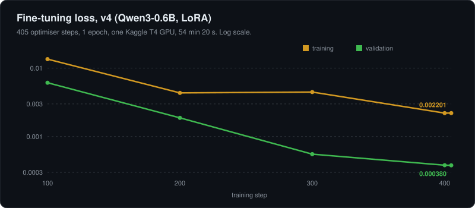
</p>

Loss also measures the answer format, so it is not an accuracy figure.

<p align="center">
  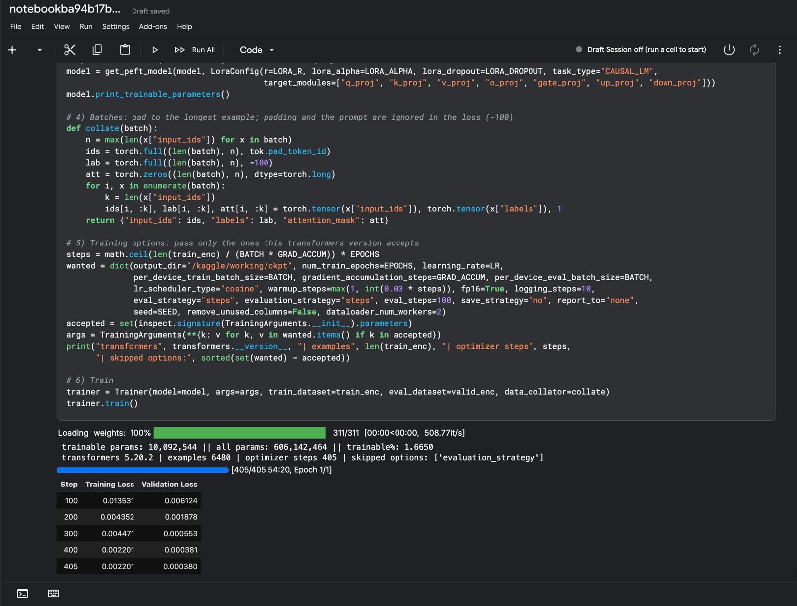
</p>

<p align="center">
  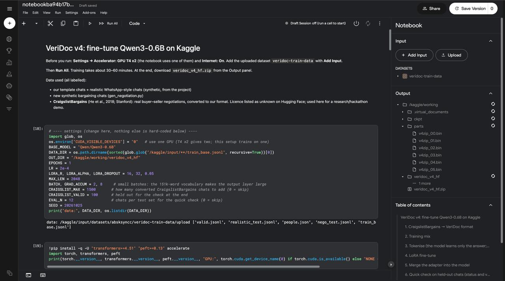
</p>

### Training data

<p align="center">
  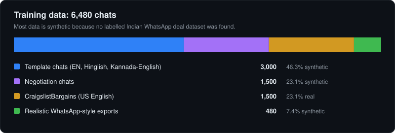
</p>

The 36 test chats, 150 negotiation chats, 100 CraigslistBargains chats and 150 validation chats were held out. 236 training chats carry injected instructions that the model learns to ignore. Only Latin script is trained (English, Hinglish, Kannada-English).

The CraigslistBargains dataset is real US English dialogue, and its licence is listed as unknown, so it is used for research and the hackathon demo only. The model must be retrained without it, or permission obtained, before any commercial release.

<p align="center">
  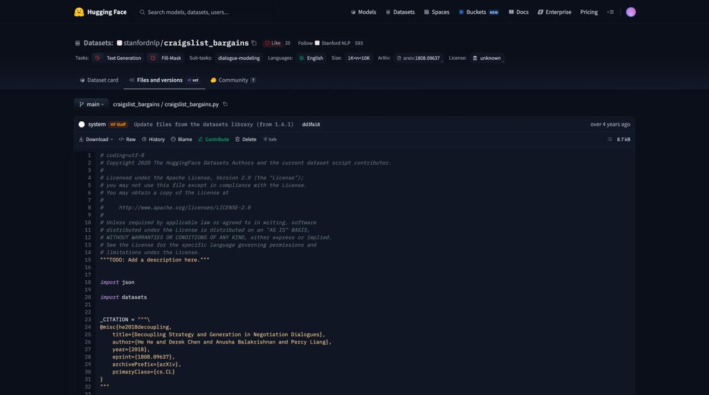
</p>

### Measured results

<p align="center">
  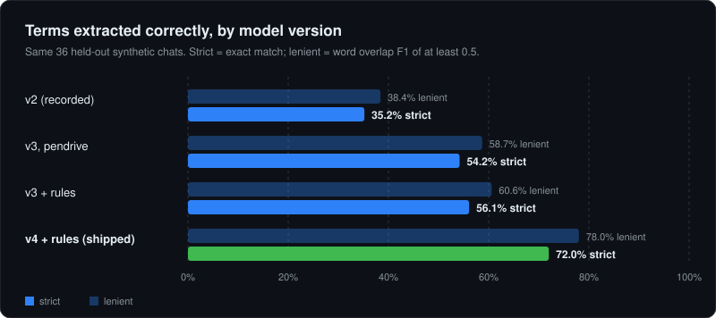
</p>

| Measure (v4 with rules, shipped) | Value |
|---|---|
| Terms correct, strict / lenient | 72.0% / 78.0% |
| Valid JSON | 100% |
| Deal type correct | 91.7% |
| Chats fully correct, strict / lenient | 2.8% / 16.7% |
| Speed | About 2 seconds per chat on a MacBook M4 |

Only 2.8% of chats come out fully correct. VeriDoc is a checker that shows what to confirm, not a system that reads chats perfectly.

### Rules layer

After the model answers, rules re-check every term against its quoted message. They repair only what the quote proves and never turn an unagreed offer into a price. Auto-repair was run on 5,406 chats with known answers and changed none of the correct ones.

<p align="center">
  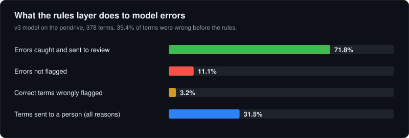
</p>

### Known failures

- Totals stated in the chat can be missed.
- A casual chat with no deal is still read as a deal.
- Unsupported deal types (rent, catering) are forced into supply order or freelance.
- A negotiated price can lose to the first offer; advance and total can be confused.
- One price-conflict test chat did not flag a contradiction (needs a human check).

Full detail and the engine's reproduction steps: [`docs/PROJECT_REPORT.md`](docs/PROJECT_REPORT.md) and [`docs/AI_SPEC.md`](docs/AI_SPEC.md) section 14.

## What is real today

Honest status (full table in [`docs/PRD.md`](docs/PRD.md) section 8):

| Area | State |
|---|---|
| Evidence vault, anchoring, verify page, redaction, share links, audit log | **Real**, inherited from DigiVault |
| Typed settings, model adapter interface, model-file hash check | **Real** |
| Chat parser (WhatsApp exports, text PDFs), term extractor with quote and value checks, seven rule flags, Chat terms screen | **Built**, runs on **recorded** model output |
| Confirming terms, recap (English and Hindi draft), suggested messages, echo code, recap PDF, chat record saved through the normal upload | **Built** |
| Voice notes in an export folder (spans, audio SHA-256, play the moment, text-versus-voice contradiction) | **Built**, on **recorded** transcripts |
| Model output in the app | **Demo.** Recorded and replayed by a fake adapter. While `MODEL_MODE=fake` (default) every page shows "Demo mode: recorded model output", and "recorded transcript" while `TRANSCRIBER_MODE=fake` |
| Offline engine (fine-tuned model, rules, terminal tools, local API) | **Real, separate codebase**, macOS tested, not connected to the app |
| Live local model in the app | **Not built.** `LocalModelAdapter` is a stub; no model is pinned in `models/manifest.json` |
| Real speech recognition | **Not built.** The local transcriber is a stub |
| Saving the pasted reply as a further version; correcting a term before confirming | **Not built** |
| Windows and Linux builds of the engine | **Packaged, untested** |

## Documents

| | |
|---|---|
| `docs/PROJECT_REPORT.md` | The full product report: problem, solution, architecture, benchmark, limits, viability, future scope |
| `docs/PRD.md` | Problem, example, users and market, flow, six features, offline engine requirements, MVP versus later, real versus demo, risks |
| `docs/TECH_STACK.md` | The stack, what we add, the local model and the offline engine stack, licences |
| `docs/ARCHITECTURE.md` | Parts, data flow from chat to receipt, the AI boundary, the offline engine |
| `docs/AI_SPEC.md` | Extraction, grounding, flags, injection defence, runtime, the engine's model, data and benchmark |
| `docs/TRIM_PLAN.md` | What is kept, renamed and removed from DigiVault, and in what order |
| `docs/DECISIONS.md` | Decision log (ADR-036 onwards are VeriDoc) |
| `docs/DEMO_RUNBOOK.md` | Click-by-click demo, one-command start, offline fallback, offline engine demo |
| `docs/PRIOR_WORK.md` | What was imported from DigiVault, what was built, third-party material and licences |
| `docs/02`, `docs/03` | Integrity references (data flow, hashing and Merkle spec) |
| `docs/digivault-archive/` | Pre-event DigiVault documents: developer guide (`DEVELOPMENT.md`), API spec, demo path, redaction measurements, and the rest (see its README) |

The documents in `docs/digivault-archive/` are DigiVault's, written before the hackathon. They are accurate for the inherited vault and still carry its original wording.

## Tech stack

| Layer | Technology |
|---|---|
| Web app | Next.js 14 (App Router), React 18, TypeScript |
| Database and storage | PostgreSQL 17 with Prisma; MinIO with Object Lock |
| Integrity | `packages/crypto-core`: PDF.js, lossless PNG, salted per-tile SHA-256, RFC 6962 Merkle trees |
| Anchoring | Solidity `EvidenceAnchorV2.sol`, Hardhat, ethers v6, Polygon Amoy (chain 80002) |
| Sign-in | Service number and PIN (bcrypt), HMAC sessions, WebAuthn step-up |
| AI service | Python, FastAPI, spaCy, Tesseract, regular expressions, `pypdf` |
| Recap output | `pdf-lib`, fontkit, merged Noto subset (Hindi shaped) |
| Offline engine | Qwen3-0.6B (LoRA, GGUF Q8_0), llama.cpp b11869, Python 3.12 standard library, python-build-standalone |
| Workspace | pnpm monorepo, Vitest, Python `unittest` |

Details, licences and settings: [`docs/TECH_STACK.md`](docs/TECH_STACK.md).

## Repository layout

```
apps/web/            Next.js app: screens, REST API, hash re-verification, anchoring, audit log, /verify
apps/ai-service/     FastAPI service: redaction suggestions, settings, model adapter, model manifest check
packages/crypto-core Browser/Node library: PDF to PNG, tiles, Merkle tree
packages/contracts   EvidenceAnchorV2.sol (and legacy v1), tests, deployment records
prisma/              schema.prisma and migrations
models/manifest.json Pinned SHA-256 of allowed model files (weights are never committed)
samples/veridoc/     Synthetic chats, reference terms and a text PDF
docs/                Documentation
docker-compose.yml   PostgreSQL and MinIO for local development
```

## Run it

### Prerequisites

- Node.js 20 or later and pnpm
- Docker (PostgreSQL and MinIO)
- Python 3 with `venv`, and Tesseract OCR with English and Hindi data (`sudo apt-get install -y tesseract-ocr tesseract-ocr-eng tesseract-ocr-hin`)
- For anchoring only: an Amoy RPC endpoint and the key of an account on `EvidenceAnchorV2`'s anchorer list, funded with Amoy test POL

### One-time setup

```bash
pnpm install
cp .env.example .env                  # names the local stack: project veridoc, Postgres :5440, MinIO :9100
docker compose up -d --wait          # its own containers, ports and volumes; the old DigiVault ones can keep running
cp apps/web/.env.example apps/web/.env.local
cp packages/contracts/.env.example packages/contracts/.env
```

Fill in `apps/web/.env.local` (`DATABASE_URL` for the `digivault_app` role, `AUTH_SESSION_SECRET`, `AMOY_RPC_URL`, `SALT_ENCRYPTION_KEY`) and `packages/contracts/.env` (`AMOY_RPC_URL`, `DEPLOYER_PRIVATE_KEY`; never commit it). `docs/digivault-archive/DEVELOPMENT.md` section 3 lists every variable. Leave `MODEL_MODE=fake`. The AI service reads plain environment variables (it has no `.env` loader), so export any of its settings before starting it, as the start command below does for `MODEL_MODE`.

```bash
pnpm exec prisma migrate deploy
docker exec veridoc-postgres psql -U veridoc -d veridoc \
  -c "ALTER ROLE digivault_app PASSWORD '<password from apps/web/.env.local>'"
cd apps/ai-service && python3 -m venv .venv \
  && .venv/bin/pip install -r requirements.txt \
  && .venv/bin/python -m spacy download en_core_web_sm && cd ../..
```

### Start

```bash
docker compose up -d --wait && (cd apps/ai-service && MODEL_MODE=fake .venv/bin/uvicorn app.main:app --port 8001 &) && MODEL_MODE=fake pnpm --filter @digivault/web dev
```

Open http://localhost:3000. The "Demo mode: recorded model output and recorded transcript" badge should show on every page. WebAuthn needs a secure context: use `http://localhost` or HTTPS.

With the web app running, seed the demo accounts and data in another terminal. The seed goes through the real upload pipeline, so it needs the web app up; without an Amoy RPC the anchors show as failed and can be retried from the version page:

```bash
cd apps/web && node --experimental-strip-types prisma/seed-demo.ts
```

It creates these accounts (development values, from `apps/web/prisma/seed-demo.ts`):

| Sign-in ID | PIN | Shown as |
|---|---|---|
| `ADMIN-ASHA` | `112233` | Admin |
| `PARTY-DEV` | `224466` | Party |
| `PARTY-IRA` | `335577` | Party |
| `REVIEWER-1` | `446688` | Reviewer (read-only) |
| `VERIFIER-1` | `557799` | Verifier (read-only) |

and two agreements: `AGR/2026/0001` (the supply-order chat export and the order confirmation) and `AGR/2026/0002` (the freelance-job chat export). For the click-by-click demo, see `docs/DEMO_RUNBOOK.md`.

### Tests

```bash
pnpm test                                                   # crypto-core, contracts and web unit tests
cd apps/ai-service && python3 -m unittest tests.test_settings tests.test_model_adapter \
  tests.test_model_manifest tests.test_samples              # settings, adapter, manifest, samples
```

The other AI-service tests (`tests/test_patterns.py` and friends) need the virtual environment: `.venv/bin/python -m unittest discover -s tests -t .`. End-to-end scripts are in `docs/digivault-archive/DEVELOPMENT.md` section 4.

Settings (`MODEL_MODE`, `MODEL_FILE_PATH`, `MODEL_SHA256`, `LLAMA_SERVER_PATH`, `PLAYBOOK_DIR`, `REDACTION_RULES_FILE`, `SHARE_LINK_TTL_HOURS`, `DATA_DIR`, `DEMO_MODE_BADGE`) are documented in the `.env.example` files and `docs/TECH_STACK.md`.

## Smart Contract

- Network: Polygon Amoy (testnet, chainId 80002)
- Both contracts below were deployed before the hackathon, as part of DigiVault (the deployment records are dated 26 September and 18 October 2026).
- **Current — EvidenceAnchorV2:** `0x01e7e6f83f55873E906465d3447cB43434D4ee67` ([explorer](https://amoy.polygonscan.com/address/0x01e7e6f83f55873E906465d3447cB43434D4ee67)), deployed in block 50527642. Owner and first anchorer: `0x30F5fD617B9f7f73eCED0FB37dB2cd7dFEB32873`. Two-step ownership transfer, anchorer allow-list with retire/revoke, audit-log heads (ADR-028). Source `packages/contracts/contracts/EvidenceAnchorV2.sol`; record `packages/contracts/deployments/amoy-v2.json`.
- **Legacy — EvidenceAnchor v1:** `0xFAf1031E2A4EF75Cf871bF93035DA062AB6D1A5b` ([explorer](https://amoy.polygonscan.com/address/0xFAf1031E2A4EF75Cf871bF93035DA062AB6D1A5b)), block 48603680, owner-only writes. Anchors written before contract v2 stay here and still verify; nothing new is written. Source `packages/contracts/contracts/EvidenceAnchor.sol`; record `packages/contracts/deployments/amoy.json`.

## Limits

- Tamper-evident, not tamper-proof. A record that was changed after saving is detected; nothing stops the change.
- The vault shows a record is unchanged since it was saved. It does not show the original chat export was genuine.
- The echo code ties a reply to one recap text. It does not show who typed the reply.
- Drafting aid, not legal advice.
- Accuracy and speed figures are targets until measured. The engine's figures come from 36 synthetic chats and are not a claim about real chats.
- The offline engine is not integrated with the app, and Windows and Linux builds of it are untested.
- Chats saved on the pendrive are not encrypted.

## Origins

VeriDoc is built on **DigiVault**, our earlier project, written before the hackathon. It was imported into this repository as one commit, `e3a0496` ("chore: import DigiVault as the project base (pre-event project, reuse approved by organiser)"), without its old Git history. The organiser approved the reuse. `docs/PRIOR_WORK.md` records what was imported and what changed.

**Reused from DigiVault.** Between the import and now, `git diff --stat e3a0496..main` shows no change to `packages/crypto-core`, `packages/contracts`, `prisma/schema.prisma` or the migrations, and only wording and default-port edits in the upload route and `storage.ts`:
- the evidence vault, with the client-first and server re-verified hashing
- the hash chain and the salted Merkle tree
- anchoring in MinIO (Object Lock) and on Polygon Amoy, and the two contracts
- redaction suggestions and tiles
- share links
- the insert-only, hash-chained audit trail
- the PDF builder behind the integrity record (reworded: it is now a draft integrity record, not a legal certificate)

**Built during the event** (`git log --oneline e3a0496..main`: 40 commits; `git diff --stat`: 131 files changed):
- chat and voice-note import (`chat_import.py`, `transcriber.py`, recorded transcripts) and the synthetic samples
- the term extractor with quote and value-versus-quote grounding (`term_extractor.py`), the model adapter and model-file check (`model_adapter.py`, `model_manifest.py`), and the Chat terms screen
- the rule flags, including text-versus-voice contradiction, and playbooks (`playbooks/`)
- the recap, echo code and recap PDF (`recap.py`, `echo-code.ts`, `recap-pdf.ts`, the Recap screen) and the chat recommendation (suggested messages, in `recap.py`)
- typed settings, the demo badge, and the chat record saved with the voice note's audio fingerprint (`chat-record.ts`)
- the wording pass (agreement, Party, Reviewer, Verifier, on the landing page, login, dashboards and verify page)
- VeriDoc's own compose stack (`docker-compose.yml`, `scripts/check-compose-isolation.sh`)
- the documentation, with the DigiVault documents moved to `docs/digivault-archive/`

## Contributors

- **Hardik Singh** ([HARDIKSINGH150206](https://github.com/HARDIKSINGH150206)): author of this repository.
- **Abhishek** ([absksync](https://github.com/absksync)): trained the local model (the weights are not in the repository).
- **Samanway** ([notorious1337](https://github.com/notorious1337)) and **Jhashank** ([NYN-05](https://github.com/NYN-05)): built part of the earlier Python version, which is reference only.

DigiVault's original authors are listed in `docs/PRIOR_WORK.md`.
