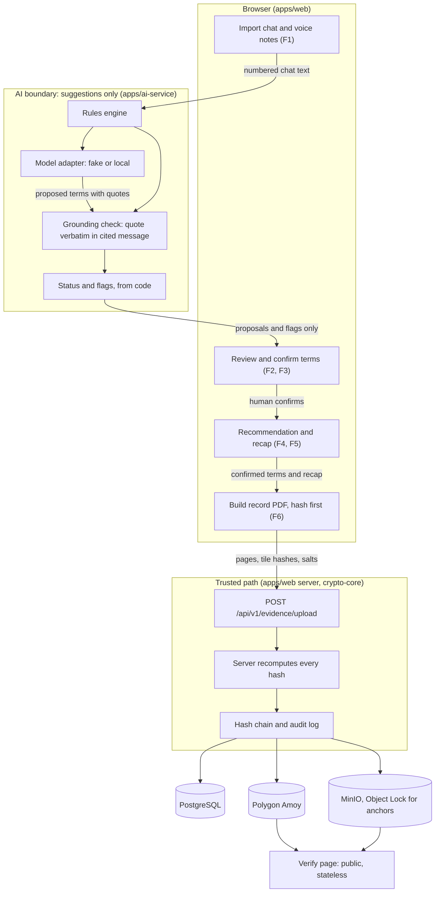

# VeriDoc — Architecture

How the parts fit together and where the AI boundary sits. The hashing, anchoring and verification details are unchanged from DigiVault and live in `docs/02-architecture-and-dataflow.md` and `docs/03-crypto-and-merkle-spec.md`. This file covers how a chat reaches them.

Status markers: **built** runs in this repository today; **planned** does not exist yet (`PRD.md` section 8).

## 1. Main parts

| Part | Where | Does | Status |
|---|---|---|---|
| Web app | `apps/web` | Screens, REST API, sign-in, hash re-verification, hash chain, anchoring, audit log | built (wording still old) |
| Crypto core | `packages/crypto-core` | PDF page to PNG, tiles, salted Merkle tree. Shared by the browser, the server and the verify page | built |
| Chat record builder | `apps/web` | Turns the imported chat into a PDF in the browser so the normal upload can hash it (ADR-040, accepted) | planned |
| AI service | `apps/ai-service` | Redaction tile suggestions (built). Term extraction, flags, recommendation, recap text (planned) | partly built |
| Model adapter | `apps/ai-service/app/model_adapter.py` | One interface, `extract(numbered_chat, playbook_id)`; fake or local behind it | built; local is a stub |
| Vault storage | PostgreSQL (Prisma), MinIO | Versions, tiles, hash chain, audit log, page PNGs, anchor records | built |
| Anchor | Polygon Amoy, `EvidenceAnchorV2.sol` | Public, append-only record of each version's commitment | built |
| Verify page | `apps/web/src/app/verify` | Public, stateless check against MinIO and Polygon. No sign-in, no database | built |

## 2. From chat to receipt

1. **Import (F1).** The browser reads the chat export. The messages are numbered from 1. Voice notes are stored with their SHA-256 and a transcript. Nothing leaves the machine.
2. **Analyse (F2, F3).** The numbered chat goes to the AI service as text. Rules run first. Then the model adapter proposes terms, each with a quote and message numbers. A grounding check drops any term whose quote is not verbatim in the cited message. Code builds the status of each term (stated, unclear, contradicted, missing) and the flags. Nothing is written anywhere. The result goes back to the browser.
3. **Confirm (F2).** The user confirms, corrects or rejects each term on screen. This is the only way a term becomes part of the record. A contradicted term needs a choice first.
4. **Recommend (F4).** Code picks the biggest gap and fills a fixed template. The user copies the text and sends it in WhatsApp. VeriDoc sends nothing.
5. **Recap (F5).** From confirmed terms only, a recap is built from fixed templates, with a 4-character echo code derived from the recap text. The user copies it to WhatsApp. The other person replies `CONFIRM <code>`. The user pastes the reply; VeriDoc checks code and sender.
6. **Save (F6).** The browser builds a PDF of the record (numbered chat, with the fingerprints of the original export and voice-note files; later the confirmed terms, recap and confirmation) and uploads it through the existing route, `POST /api/v1/evidence/upload`. Each step after the first is a new version of the same document (`document_id`), so the hash chain links them. The browser hashes first, the server recomputes, the version is anchored in MinIO and on Polygon Amoy, and the audit log records it.
7. **Receipt.** The user gets the verification files and a link to the verify page. A reviewer opens the link with no account. The page recomputes from the files and compares with the anchor.

The echo code is not part of any Merkle tree. It is derived from the recap text (an algorithm adapted from the earlier VeriDoc design: a hash of the text, the first 20 bits written as 4 characters from the Crockford base32 alphabet) and is only a binding check between a reply and one exact recap. It does not identify who typed the reply.

## 3. Diagram

The only arrow out of the AI boundary goes to the review screen. Nothing from the AI boundary reaches the upload route, the hash path, the audit log or the stores.

## 4. Where the AI boundary sits

| Rule | How it is kept |
|---|---|
| The AI never writes to the vault, the audit log or the hash path | The AI service has no database or MinIO credentials and calls no vault route. It returns data to the web app, which shows it. A term reaches the vault only because a signed-in person confirmed it and the browser uploaded it |
| Merkle roots come from raw tile pixel hashes | Unchanged (`CLAUDE.md` rule 2). OCR or model failure cannot affect a proof |
| Every term needs a source quote and a human confirmation | Enforced in code before the term is shown as proposed (`AI_SPEC.md` sections 4–5) |
| Chat text is data, never instructions | The model sees chat only inside a fenced data block with a fixed system instruction, and its output is schema-constrained and grounded (`AI_SPEC.md` section 6) |
| Rules first, model second | The model is only asked about what rules did not settle, and a disagreement is shown as "needs review" (`AI_SPEC.md` section 3) |
| Recorded output is labelled | While `MODEL_MODE=fake` the web app shows "Demo mode: recorded model output" on every page |

## 5. Trust boundaries

| Boundary | Trusted for | Not trusted for |
|---|---|---|
| Browser | Producing pages and a first hash | The hash itself; the server recomputes |
| AI service and model | Suggestions | Anything on the hash path; anything final without a person |
| Chat text | Being the data to analyse | Being instructions |
| App server and database | Workflow, access control | Being the source of truth for integrity; the anchor is |
| Database owner | Operations | Changing evidence undetected (anchors) or the audit log undetected (chain plus anchored heads) |
| Polygon Amoy | A timestamped, append-only record of commitments | Holding any content (it holds none) |
| Pasted WhatsApp reply | Carrying the echo code | Proving who typed it |

## 6. What is not changed

- The data model, the `Role` enum and every audit action string (ADR-039).
- The 20×20 grid, PNG-only pages, the proof format (`docs/03`).
- The public, stateless verify page (`CLAUDE.md` rule 5).
- Dual anchoring of every version (`CLAUDE.md` rule 3).
